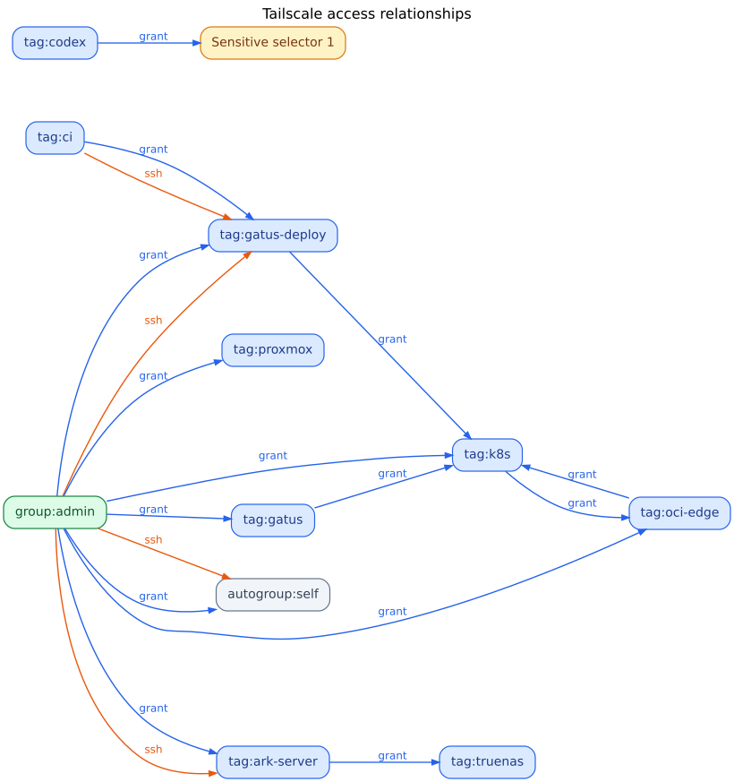

# Tailscale ACL

GitOps source for the Tailscale tailnet policy. The source is split into ordinary
Tailscale JSON sections. The build creates one policy file for Tailscale.

## Files

* `policy/grants.json`: plaintext `grants` rules.
* `policy/ssh.json`: plaintext `ssh` rules.
* `policy/tests.json`: plaintext policy tests.
* `policy/tag-owners.json`: plaintext tag names and owners.
* `secrets.sops.json`: encrypted group membership and private host addresses.
* `scripts/render-policy.sh`: merges the fragments into a mode `0600` policy file in a
  temporary directory.
* `scripts/policy-graph.py`: creates a Graphviz view from the plaintext grant and SSH
  sections. It omits group membership and redacts selectors outside public group, tag,
  and autogroup names.
* `docs/access-graph.svg`: generated image shown below and refreshed automatically on
  same-repository pull requests when grant or SSH rules change.

The SOPS `encrypted_regex` in `.sops.yaml` matches keys beginning with `group:` or
`private-`. It encrypts group membership values and private host addresses while keeping
the group names and host aliases visible as JSON keys. SOPS leaves keys visible and
applies `encrypted_regex` to values whose key names match the expression
([SOPS reference](https://getsops.io/docs/reference/)). Put private IP addresses or
CIDR ranges in `hosts` under a `private-*` alias. Keep rule selectors, tags, groups,
and tests in plaintext for review.

## Codex Cloud identity

Codex Cloud uses the dedicated `tag:codex` identity. Its grant permits only TCP 6443
and TCP 50000 to the encrypted `private-control-plane` host alias. It has no SSH rule
and no access to user-owned devices or other tagged services. User terminals continue
to use their user identity and existing grants.

Configure the Codex Cloud environment's Tailscale VPN with a dedicated auth key that
has the `tag:codex` tag and both **Reusable** and **Ephemeral** enabled. Do not reuse a
personal or untagged key. The tag makes the device tag-owned instead of user-owned;
ephemeral nodes are removed after disconnecting. Tailscale auth keys expire within
90 days, so replace the environment credential before its expiry. The key can register
multiple Codex nodes, but the ACL limits those nodes to the two control-plane ports
above. If the environment exposes the credential to task processes, those processes
can use it to register another similarly restricted node.

Apply the policy before creating the tagged key so `tag:codex` exists in the tailnet.
After replacing the environment credential, verify the new Codex device has the
`tag:codex` identity and no user owner. Remove obsolete Codex devices individually
after confirming they are old Codex nodes; do not remove other devices owned by the
same user.

## Merge and validation

Each plaintext source is a JSON object with a distinct Tailscale top-level key. The
build sends SOPS plaintext directly to `jq`; it does not write a decrypted secrets
fragment. It rejects non-object fragments and duplicate top-level keys before combining
them. The generated policy was compared semantically with the previous policy before
this refactor was prepared.

## Key management

The repo-specific age private key is stored in the `homelab` 1Password vault as the
Secure Note **Tailscale ACL repo SOPS age key**. `fnox.toml` retrieves it through
1Password as a temporary local file and exports its path as `SOPS_AGE_KEY_FILE` only to
the command started by fnox. GitHub Actions uses the repository secret `SOPS_AGE_KEY`
for CI decryption. The public age recipient is in `.sops.yaml`.

GitHub Actions uses a read-only Tailscale identity for pull request tests and a
write identity restricted to `main` for deployment. Configure these repository
Actions variables:

| Variable | Value |
| --- | --- |
| `TS_OAUTH_ID_READ` | Client ID of the read-only federated identity |
| `TS_AUDIENCE_READ` | Audience of the read-only identity |
| `TS_OAUTH_ID_WRITE` | Client ID of the write federated identity |
| `TS_AUDIENCE_WRITE` | Audience of the write identity |
| `TS_TAILNET` | Tailnet name (`chik4ge-homelab.org.github`) |

In Tailscale, create two GitHub OpenID Connect federated identities with issuer
`https://token.actions.githubusercontent.com`. Restrict their subjects to the exact
immutable GitHub subjects below; do not use a wildcard:

| Identity | Subject | Scopes |
| --- | --- | --- |
| PR test | `repo:chik4ge-homelab@192598607/tailscale-acl@1448596926:pull_request` | `policy_file:read`; the console adds its required read-only device scopes |
| Main deploy | `repo:chik4ge-homelab@192598607/tailscale-acl@1448596926:ref:refs/heads/main` | `policy_file`; the console adds its required device scopes |

Leave the audience field empty to use Tailscale's generated audience (`api.tailscale.com/<client ID>`), then copy each identity's client ID and audience into the matching GitHub variables above. Pull requests use only the read identity; pushes to `main` use only the write identity. `SOPS_AGE_KEY` is the GitHub Actions secret used for policy rendering. `workflow_dispatch` renders the policy only.

## Editing and encryption

Edit the four files under `policy/` as normal Tailscale policy JSON. This keeps
`grants`, `ssh`, `tests`, and tag ownership easy to review independently.

To edit encrypted values, use SOPS' editor with the local key supplied through fnox:

```sh
mise exec -- fnox --non-interactive --if-missing error --no-daemon exec sops secrets.sops.json
```

To create or restructure the encrypted data, prepare `secrets.json` with restrictive
permissions. It is ignored by Git. Include the `groups` object and a `hosts` object with
private addresses keyed by `private-*` aliases, then encrypt it using the public age
recipient:

```sh
set -eu
umask 077
# Write the groups object to secrets.json.
encrypted_tmp="$(mktemp)"
trap 'rm -f "$encrypted_tmp"' EXIT
mise exec -- sops --encrypt --input-type json --output-type json \
  secrets.json > "$encrypted_tmp"
chmod 0644 "$encrypted_tmp"
mv "$encrypted_tmp" secrets.sops.json
rm -f secrets.json
```

Do not print or commit plaintext values, generated policies, or the private age key.
`.gitignore` excludes local secret fragments, graph output, and local key files.

## Render and deploy

Render locally and capture the generated file path without displaying policy contents:

```sh
policy_file="$(mise exec -- fnox --non-interactive --if-missing error --no-daemon exec scripts/render-policy.sh)"
```

In CI, the file is created under `RUNNER_TEMP`; locally it uses the operating system's
temporary directory. The script prints the path, sets the GitHub step output, and writes
the file with mode `0600`. GitHub Actions passes that path to the Tailscale action and
removes the file after the job. A pull request to `main` tests the generated policy
when Tailscale credentials are configured; a push to `main` applies it when those
credentials are configured.

## Access graph



The access-graph workflow regenerates the SVG from `policy/grants.json` and
`policy/ssh.json`. If it changes, the workflow commits the new image to the PR branch,
so the README preview shows the updated graph. Add the `ACCESS_GRAPH_TOKEN` repository
Actions secret for this push. Use a fine-grained token scoped to this repository with
only `Contents: Read and write`; store it in the `homelab` 1Password vault as
**Tailscale ACL graph updater token**. The workflow uses the token only for the graph
commit and keeps `GITHUB_TOKEN` read-only.
Group membership is not included, and unrecognized selectors use generic labels. Blue
edges are grants and orange edges are SSH; green nodes are groups and blue nodes are tags.

Grants are deny-by-default and additive: every permitted flow must be listed, and a
broader grant is not narrowed by a more specific one. Keep access from untagged admin
devices scoped to explicit destinations and ports; Tailscale SSH also needs a matching
network grant for TCP port 22 in addition to its `ssh` rule.

See [Tailscale GitOps for GitHub Actions](https://tailscale.com/docs/integrations/github/gitops)
and [Tailscale policy syntax](https://tailscale.com/docs/reference/syntax/policy-file).
